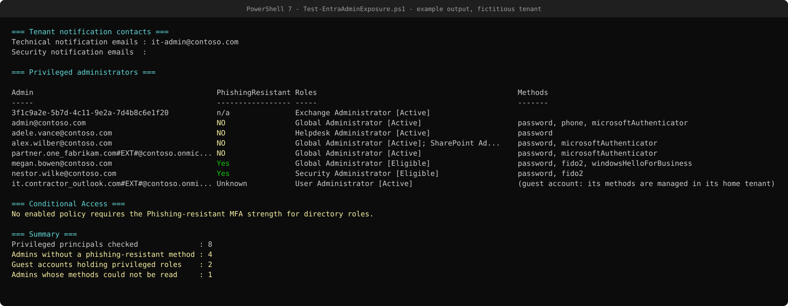

# Entra Admin Exposure Check

A read-only PowerShell script that shows where a phishing campaign against your Microsoft Entra ID administrators would hit the weakest point.

It answers four questions about your tenant, without changing anything:

| # | Question | Why it matters |
| --- | --- | --- |
| 1 | Which addresses receive technical and security notifications? | Attackers imitate these notices. A missing security contact means warnings go nowhere. |
| 2 | Who holds the most privileged directory roles, active or PIM-eligible? | These accounts are the targets once their email addresses are known. |
| 3 | Which of them has **no phishing-resistant method** registered? | Passwords, SMS codes and push notifications can be relayed by an adversary-in-the-middle page. Passkeys (FIDO2), Windows Hello for Business and certificates cannot. |
| 4 | Does an enabled Conditional Access policy require phishing-resistant MFA for directory roles? | A registered method only protects the account if a policy enforces it. |

## Example output

Fictitious tenant (Contoso), for illustration only:



The same output as text is in [docs/sample-output.txt](docs/sample-output.txt).

## Requirements

- PowerShell 7
- Microsoft Graph PowerShell SDK:

  ```powershell
  Install-Module Microsoft.Graph -Scope CurrentUser
  ```

- An account with the **Global Reader** role. It is the least privileged built-in role that can read other users' authentication methods.
- Consent to these **read-only** delegated permissions: `Organization.Read.All`, `RoleManagement.Read.Directory`, `UserAuthenticationMethod.Read.All`, `Policy.Read.All`.

## Usage

```powershell
.\Test-EntraAdminExposure.ps1

# Optional: export the administrator table
.\Test-EntraAdminExposure.ps1 -CsvPath .\privileged-admins.csv
```

A sign-in window opens. Sign in with the Global Reader account and accept the permissions.

## Reading the results

| Value | Meaning |
| --- | --- |
| `Yes` | At least one phishing-resistant method is registered. Check that a policy also enforces it. |
| `NO` | Only phishable methods: password, phone, Microsoft Authenticator push or code. Priority to fix. |
| `Unknown` | Methods could not be read. For a guest account, its methods are managed in its home tenant. |
| `n/a` | The role is held by a group or a service principal, not by a user. |

The summary also counts **guest accounts holding privileged roles**. A guest with a standing Global Administrator role depends on the security of another organisation's tenant.

## What to do with the findings

1. Register a passkey or Windows Hello for Business for every administrator, using a Temporary Access Pass if needed.
2. Create a Conditional Access policy that requires the built-in **Phishing-resistant MFA** authentication strength for directory roles. Exclude emergency access accounts and start in **report-only** mode.
3. Remove standing privileged roles where possible, and use Privileged Identity Management (PIM) for activation on demand.
4. Review every guest account that holds a privileged role.
5. Set a security notification contact for the tenant.

## Limits

- Only built-in roles are checked: the fourteen roles that Microsoft recommends protecting with phishing-resistant MFA at a minimum.
- PIM-eligible assignments require Microsoft Entra ID P2. Without it, only active assignments are listed.
- The Conditional Access check looks for the built-in Phishing-resistant MFA strength. Custom authentication strengths are not evaluated.
- If a cmdlet fails to load, the Microsoft Graph modules are probably installed in different versions. Run `Update-Module Microsoft.Graph`.

## Background

[Your Admin Emails Leaked: What Comes Next, and Where to Break the Chain](https://www.solisys.be/blog/entra-connect-health-leak-what-comes-next/)

## References

- [Require phishing-resistant multifactor authentication for administrators](https://learn.microsoft.com/en-us/entra/identity/conditional-access/policy-admin-phish-resistant-mfa)
- [Conditional Access authentication strengths](https://learn.microsoft.com/en-us/entra/identity/authentication/concept-authentication-strengths)
- [List authentication methods (Microsoft Graph)](https://learn.microsoft.com/en-us/graph/api/authentication-list-methods)
- [organization resource type](https://learn.microsoft.com/en-us/graph/api/resources/organization)

## License

[MIT](LICENSE)
